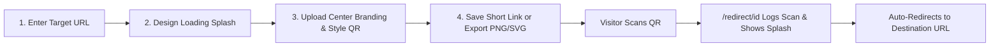

<div align="center">
  
  <h1>SnapQR</h1>
  <p><strong>Dynamic QR Code Studio &amp; Branded Loading Splash Screens</strong></p>
  <p>
    Transform ordinary links into memorable brand experiences with custom center logos,
    live mobile splash previews, high-resolution PNG/SVG exports, and MongoDB scan analytics.
  </p>

  <p>
    
    
    
    
    
  </p>
</div>

---

## ✨ Highlights

| Feature | Description |
| :--- | :--- |
| **🖼️ Custom QR Center Branding** | Upload any **PNG, JPG, WebP, GIF, or SVG** logo via click or drag-and-drop. Customize frame shape (**Rounded**, **Circle**, **Square**, or **No Frame**), badge fill (**Pure White** or **Match QR Background**), and center size (**14%–28%**). |
| **⏳ Branded Loading Splash** | Greet visitors with custom headline messages, brand footnotes, configurable redirect delays (`1s–5s`), and animated CSS spinners (**Dual Ring**, **Pulse Wave**, **Orbiting Spheres**). |
| **🎨 Full Visual Customization** | Pick foreground & background colors via hex pickers or curated swatches, add an optional QR card title, and choose Reed-Solomon error correction (`L`, `M`, `Q`, `H`). |
| **📱 Dual-Mode Live Studio** | Toggle in real time between the **QR Code View** and **Loading Screen** mobile preview, or launch the fullscreen **Scan Simulator** modal before publishing. |
| **📐 High-Res PNG & Vector SVG** | Export crisp **512px / 1024px / 2048px PNGs** or self-contained **SVG** files with embedded center branding and preserved aspect ratios. |
| **📊 Dynamic Links & Scan Tracking** | Persist configurations in **MongoDB** with short `/redirect/<id>` links, automatic scan counters, and direct `/qr-image/<id>` rendering. |

---

## 🔄 How It Works



---

## 🛠️ Tech Stack

- **Backend:** Python, Flask, Werkzeug, Jinja2, `python-dotenv`
- **QR & Imaging:** `qrcode[pil]`, Pillow (`StyledPilImage`, `RoundedModuleDrawer`), client-side `qrcode.min.js`
- **Database:** MongoDB (`pymongo`)
- **Frontend:** Vanilla JavaScript, HTML5 Canvas, CSS3 (Dark Glassmorphism UI), Font Awesome 6, Google Fonts (`Outfit`, `Plus Jakarta Sans`)
- **Hosting:** Ready for Vercel serverless deployment (`vercel.json` + `index.py`)

---

## 🚀 Quick Start

### 1. Clone the Repository

```bash
git clone https://github.com/akshaykumar401/snapqr
cd SnapQR
```

### 2. Create a Virtual Environment & Install Dependencies

```bash
python -m venv .venv
```

**Windows (PowerShell):**
```powershell
.\.venv\Scripts\Activate.ps1
pip install -r requirements.txt
```

**macOS / Linux:**
```bash
source .venv/bin/activate
pip install -r requirements.txt
```

### 3. Configure Environment Variables

Copy `.env.example` to `.env` and set your MongoDB connection string:

```bash
cp .env.example .env
```

```env
MONGO_URI=mongodb://localhost:27017/
DB_NAME=snapqr_db
PORT=5000
DEBUG=True
```

> **Note:** Even without an active MongoDB connection, the studio preview and client/backend PNG & SVG downloads remain usable for direct URL QR codes.

### 4. Run the Application

```bash
python wsgi.py
```

Open **`http://localhost:5000`** in your browser to launch the SnapQR Studio.

---

## 🔌 API Reference

| Method & Endpoint | Description |
| :--- | :--- |
| `GET /` | Serves the interactive SnapQR Studio (`Home.html`). |
| `POST /api/create` | Saves a dynamic QR record (URL, splash text, colors, error correction, and optional `custom_logo` data URI) to MongoDB and returns `short_id` + `short_url`. |
| `GET /redirect/<id>` | Increments `scan_count`, updates `last_scanned_at`, renders the branded splash screen, and redirects to `target_url`. |
| `GET /api/qr/<id>` | Fetches stored QR metadata and scan analytics (`scan_count`, `created_at`, `last_scanned_at`). |
| `GET /qr-image/<id>` | Renders the saved QR code with its custom center branding as PNG (or `?format=svg`). |
| `GET \| POST /api/download-qr` | Generates and downloads a custom branded QR code directly in `png` or `svg` format. |

<details>
<summary><strong>Example <code>POST /api/create</code> Request</strong></summary>

```json
{
  "target_url": "https://example.com/launch",
  "loading_message": "Hold tight! Taking you there...",
  "loading_subtext": "Powered by SnapQR",
  "redirect_delay": 3,
  "spinner_style": "dual-ring",
  "title": "Scan to Explore",
  "fg_color": "#9FA0FF",
  "bg_color": "#ffffff",
  "include_logo": true,
  "custom_logo": "data:image/png;base64,...",
  "logo_size": 22,
  "logo_shape": "rounded",
  "logo_bg": "white",
  "ecc_level": "H"
}
```

</details>

---

## ☁️ Deployment (Vercel)

SnapQR includes `vercel.json` and `index.py` for zero-config Vercel Python deployment:

1. Push your repository to GitHub/GitLab/Bitbucket and import it into Vercel.
2. Add `MONGO_URI`, `DB_NAME`, and `SECRET_KEY` in your Vercel project's **Environment Variables**.
3. Deploy — all routes are handled via `index.py` -> `wsgi.py`.

---

<div align="center">
  <p>Crafted under <a href="https://silver-pixel-soft.pages.dev/"><strong>Silver Pixel Soft</strong></a></p>
</div>

